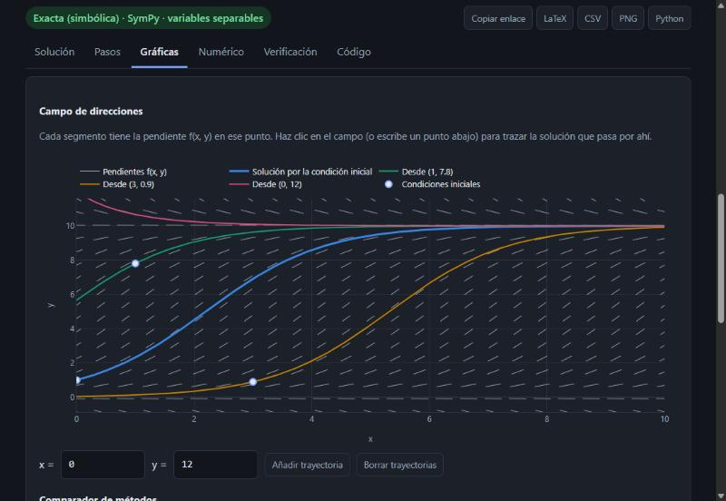
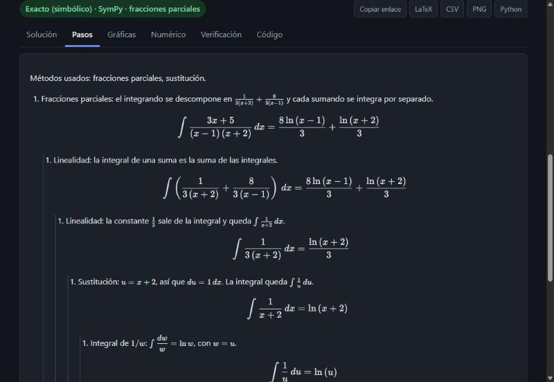
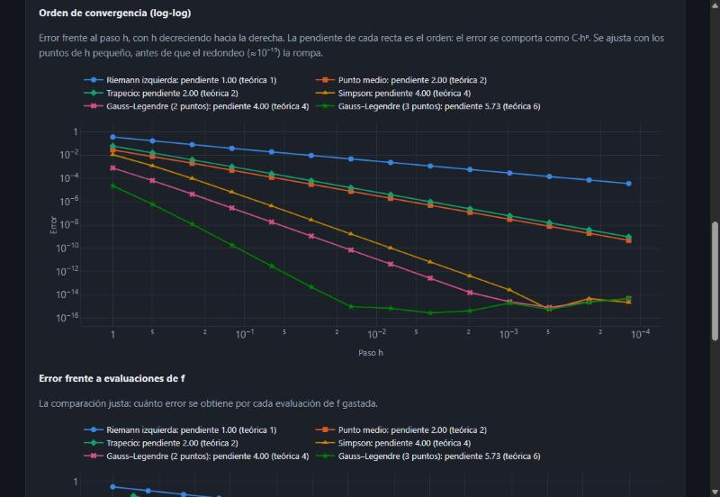

# DiffEq Lab

[](https://github.com/Ryzen648/diffeq-lab/actions/workflows/pruebas.yml)

Laboratorio interactivo de **integrales** y **ecuaciones diferenciales ordinarias**. No se limita a dar la respuesta: muestra el método, el error y la visualización.

**https://ryzen648.github.io/diffeq-lab/**

Es una página estática. Todo se calcula en el navegador, sin servidor: los métodos numéricos están programados a mano en JavaScript, y la parte simbólica usa SymPy dentro del navegador (Pyodide).

| | |
|---|---|
|  |  |
|  |  |

## Qué hace

### Integrales (Fase 1a)

- **Primitiva paso a paso** con el método nombrado: sustitución, por partes (también cíclica), fracciones parciales, identidades trigonométricas, sustitución trigonométrica, completar el cuadrado y funciones especiales.
  - Los pasos salen del árbol de reglas de SymPy (`integral_steps`), traducido al español con LaTeX.
- **Sumas de Riemann** (izquierda, derecha y punto medio) con un deslizador para el número de rectángulos.
- **Cuadratura numérica:** punto medio, trapecio, Simpson y Gauss–Legendre de 2 y 3 puntos.
  - Tabla de errores y gráfica log-log del error frente a h, con la **pendiente observada junto al orden teórico**.
  - Error frente al número de evaluaciones, que es la comparación justa entre métodos.
  - Gauss–Legendre de n puntos en escala semilogarítmica, porque su convergencia es exponencial.
- **Simpson adaptativo**, mostrando dónde refina.
- **Integrales impropias** (límites infinitos y singularidades en los extremos o en el interior):
  - criterio de comparación con p-integrales, estimando el exponente;
  - cuadratura doble exponencial (tanh-sinh);
  - sucesión de integrales truncadas;
  - el veredicto de SymPy.
- Detecta cuándo la **regla de Barrow aplicada a ciegas** da un valor falso. Ejemplo: ∫₋₁¹ 1/x² dx "= −2", cuando en realidad diverge.

### EDO de primer orden (Fase 1b)

- **Notación flexible:** `y' = x*y`, `dy/dx = x*y`, `2*x*y + (x^2+3*y^2)*y' = 0`, `dy/dt = -k*y` o solo `x*y`.
  - Reconoce también las de orden 2 y las EDP (`y''`, `u_t = k*u_xx`, `∂u/∂t`) y avisa de que llegan en fases posteriores.
- **Clasificación en vivo** mientras se escribe: orden, lineal o no, homogénea, separable, Bernoulli (con su n), exacta, Riccati y autónoma.
- **Parámetros detectados solos** (`r`, `K`, `k`…), cada uno con su deslizador:
  - lo numérico se actualiza al mover;
  - lo simbólico se recalcula al soltar.
- **Campo de direcciones:** un clic (o el formulario accesible) traza la solución que pasa por ese punto.
- **Comparador de métodos:**
  - Euler, Heun (RK2), RK4 y Dormand–Prince 5(4) adaptativo;
  - curvas juntas y error a lo largo de x frente a la solución exacta.
- **Orden de convergencia observado**, y error frente a evaluaciones (Dormand–Prince varía su tolerancia).
- **Rigidez:**
  - estima λ = ∂f/∂y a lo largo de la solución y calcula el paso máximo estable;
  - con un deslizador de h se compara Euler explícito con Euler implícito y con el trapecio implícito.
- **Solución simbólica paso a paso** para cuatro tipos: separable, lineal (factor integrante), Bernoulli y exacta (incluidos los factores integrantes μ(x) y μ(y)).
  - Aplica la condición inicial.
  - Avisa de las soluciones de equilibrio que se pierden al separar variables.

### Común a los dos módulos

- Editor **visual** (MathLive) o **de código**.
- Resultados en pestañas: Solución, Pasos, Gráficas, Numérico, Verificación y Código.
- **Etiqueta de confianza:** dice si el resultado es exacto (simbólico) o numérico, y con qué método. Si los dos no coinciden, lo señala en rojo.
- **Verificación doble:**
  - sustitución simbólica (residuo F′ − f o y′ − f(x, y) en SymPy);
  - comprobación independiente en JavaScript, sin SymPy: derivada numérica de la primitiva, o comparación con Dormand–Prince con tolerancia 10⁻¹².
- **«Ver código Python equivalente»** con NumPy, SciPy y SymPy. La integración continua ejecuta el código de cada ejemplo y comprueba que da lo mismo que la página.
- **Estado compartible por URL** (`integrales.html#f=x*exp(x)&a=0&b=1`).
- Exportación a PNG, CSV, LaTeX y Python.
- **Web Workers:** SymPy y los estudios de convergencia corren en segundo plano, con tiempo máximo y reinicio si un cálculo no termina.
- Tema claro, oscuro o automático. Diseño responsive y accesible: pestañas con teclado, etiquetas ARIA y una paleta validada para daltonismo.
- En el móvil, el teclado en pantalla no tapa el botón «Calcular» ni el resultado.
- Interfaz preparada para traducir: español por defecto; el inglés se completará en la Fase 5.

## Cómo funciona

| Pieza | Decisión y motivo |
|---|---|
| Sitio | Estático, sin build, en GitHub Pages. Módulos ES y librerías desde CDN. |
| Núcleo numérico | Escrito a mano en `src/nucleo/`, sin DOM y sin librerías de integración: cada método está explicado en los comentarios de su archivo. Las expresiones se compilan a funciones de JavaScript (no se evalúa el árbol de math.js en cada punto), porque un estudio de convergencia pide millones de evaluaciones. |
| Parte simbólica | SymPy 1.14.0 en Pyodide 314.0.8, en un Web Worker que se carga bajo demanda (ver «Limitaciones»). Los pasos de las EDO son plantillas propias: `dsolve` no da pasos y, medido, tardaba más de 20 s en algunas exactas. |
| Gráficas y fórmulas | Plotly (paquete cartesiano) y KaTeX. |
| Código compartido | [lab-comun](https://github.com/Ryzen648/lab-comun) como submódulo `comun/`, compartido con la [calculadora de gradientes y jacobianos](https://github.com/Ryzen648/gradientes-jacobianos): editor visual, tema, lectura de expresiones con mensajes de error útiles e i18n. |

### Órdenes de convergencia comprobados

Las pruebas exigen que la pendiente log-log observada esté cerca del orden teórico. Valores medidos con f(x) = eˣ en [0, 1]:

| Regla | Orden teórico | Pendiente observada |
|---|---|---|
| Riemann (extremo izquierdo) | 1 | 1.000 |
| Punto medio | 2 | 2.000 |
| Trapecio | 2 | 2.000 |
| Simpson | 4 | 4.000 |
| Gauss–Legendre, 2 puntos (compuesta) | 4 | 4.000 |
| Gauss–Legendre, 3 puntos (compuesta) | 6 | 5.994 |

Con √x en [0, 1] todas bajan a ≈ 1.5, porque la derivada no está acotada en 0. Hay una prueba que lo comprueba: la página no le atribuye a Simpson un orden 4 que ahí no tiene.

En EDO, Euler, Heun y RK4 dan pendientes 1, 2 y 4 (±0.1) en y′ = y y en y′ = −2xy. En la ecuación logística la página muestra 1.00, 2.00 y 4.03.

**Rigidez**, con y′ = −50(y − cos x): Euler explícito es estable solo si h < 2/50 = 0.04. Con tolerancia 10⁻³ hasta x = 20, Dormand–Prince necesita 336 pasos, frente a 28 con λ = −1: su paso queda atado al límite de estabilidad, no a la precisión.

## Pruebas

- **JavaScript** (`node:test`): 79 pruebas en 10 archivos.
  - Cada método se compara con soluciones analíticas conocidas.
  - Se comprueba el orden de convergencia, la exactitud de Gauss–Legendre hasta grado 2n − 1 (y el error exacto en grado 2n) y la estabilidad en el problema rígido.
  - También se prueban la notación, la clasificación y que todos los textos y códigos de error existan.
- **Python:** 26 pruebas de la parte simbólica (pasos, métodos, verificación) y una prueba por cada ejemplo que ejecuta el código Python generado.
  - En CI corren con pytest sobre CPython y SymPy 1.14.0.
  - En local, `npm run test:py` las ejecuta dentro de Pyodide, sin instalar Python.

Los 15 scripts generados para los ejemplos coinciden con la página con diferencias de entre 10⁻¹⁷ y 10⁻¹¹.

## Desarrollo

Requisitos: Node.js 22 o posterior. Python no hace falta.

Clona con los submódulos:

```bash
git clone --recurse-submodules https://github.com/Ryzen648/diffeq-lab.git
```

Instala las dependencias de desarrollo:

```bash
npm install
```

Ejecuta las pruebas de JavaScript:

```bash
npm test
```

Ejecuta las pruebas de Python dentro de Pyodide (descarga SymPy la primera vez):

```bash
npm run test:py
```

Genera el código Python de los ejemplos, ejecútalo y compáralo con la página:

```bash
npm run test:codigo
```

Abre el sitio en http://localhost:8767/:

```bash
npm run servir
```

**Despliegue:** `.github/workflows/pages.yml` publica en GitHub Pages en cada push a `main`, solo si pasan las pruebas. Hay que configurar una vez *Settings → Pages → Source: GitHub Actions*.

## Estructura

```
├─ index.html · integrales.html · edo1.html
├─ comun/                      submódulo lab-comun (editor, tema, entrada, i18n)
├─ css/lab.css
├─ src/
│  ├─ nucleo/                  sin DOM, probado en Node
│  │  ├─ expresion.js          texto validado -> función JS compilada
│  │  ├─ convergencia.js       orden observado (regresión log-log)
│  │  ├─ cuadratura/           Riemann, Newton–Cotes, Gauss–Legendre, adaptativa, doble exponencial, impropias
│  │  ├─ edo/                  Euler/Heun/RK4, Dormand–Prince, implícitos, campo, notación, clasificación
│  │  └─ codigo/               generadores de código Python
│  ├─ simbolico/               Worker de Pyodide, cliente y módulos de Python (pasos, métodos)
│  ├─ workers/                 RPC con tiempo máximo y Worker numérico
│  ├─ ui/                      páginas, gráficas, pestañas, campo de fórmula, deslizadores
│  └─ i18n/                    textos (es, en)
├─ tests/                      node:test y tests/python (pytest)
└─ scripts/                    servidor local y ejecutores de pruebas
```

## Limitaciones

- **Primera carga de la parte simbólica:** ≈10 MB comprimidos (Pyodide y SymPy). Después quedan en la caché del navegador. Mientras cargan, la parte numérica ya funciona.
- **Cobertura de los pasos de integrales.** Medida con una batería propia de 57 integrales de libro (una muestra, no una estadística): `integral_steps` da pasos completos en 50.
  - Sin pasos, pero con resultado de `integrate`: sec³x, cosh²x, 1/(1+x⁴), 1/(sen x + cos x) y 1/(2 + cos x). SymPy no implementa la sustitución de Weierstrass en los pasos.
  - Ni siquiera `integrate` encuentra la primitiva de √(tan x), aunque es elemental.
  - xˣ no tiene primitiva elemental.
- **Logaritmos:** SymPy escribe ln u donde la primitiva real es ln|u|. La página lo avisa en vez de cambiarlo.
- **Integrales impropias:** decidir la convergencia en general es imposible.
  - El criterio numérico no decide cuando el exponente es ≈ 1 (lo intenta con la sucesión truncada) ni con integrandos oscilantes.
  - La detección de singularidades interiores es numérica.
  - Cuando SymPy da un veredicto exacto, prevalece.
  - Con 1/√(1−x²), la cuadratura tanh-sinh pierde precisión (≈10⁻⁸) por la cancelación al calcular 1 − x² cerca de ±1.
- **Clasificación en vivo:** es una comprobación numérica en puntos de prueba. La definitiva es la de SymPy al calcular.
- **Solo EDO de primer orden con una función desconocida.** Las de orden 2, los sistemas y las EDP se reconocen, pero se resuelven en fases posteriores.
- **Despejar y:** solo se intenta cuando es razonable (polinómica de grado ≤ 2, o y aparece como mucho dos veces). Si no, la solución queda en forma implícita, que es correcta.
- **Parámetros en la parte simbólica:** se sustituyen por su valor numérico exacto (0.3 → 3/10). Se recalcula al soltar el deslizador, no se resuelve con el parámetro como símbolo.
- **Dominio real:** (−8)^(1/3) da NaN, como en una calculadora. Para la raíz cúbica real se usa `cbrt` o `nthRoot`.
- El inglés está incompleto: lo que falta se muestra en español.

## Lo que queda (Fases 2, 3 y 5)

- **Fase 2. EDO de orden 2 y sistemas 2×2:**
  - retratos de fase;
  - equilibrios y su estabilidad por los autovalores del jacobiano;
  - ejemplos: péndulo, Van der Pol, Lotka–Volterra.
  - Lorenz es un sistema 3D: amplía el alcance 2×2 previsto.
- **Fase 3. EDP:**
  - calor 1D, onda 1D y Laplace 2D por diferencias finitas, con animación y series de Fourier;
  - análisis de estabilidad (condición CFL).
- **Fase 5 (opcional):**
  - traducción completa al inglés;
  - integrales dobles y Monte Carlo;
  - modo práctica e historial.

## Autor y licencia

Ricardo Jaico Pradinett, estudiante de Ingeniería de Inteligencia Artificial (UNMSM, Lima). Código bajo licencia MIT.
